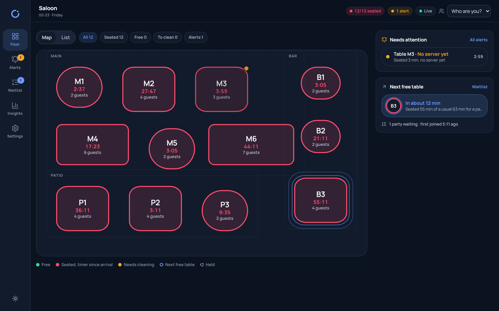
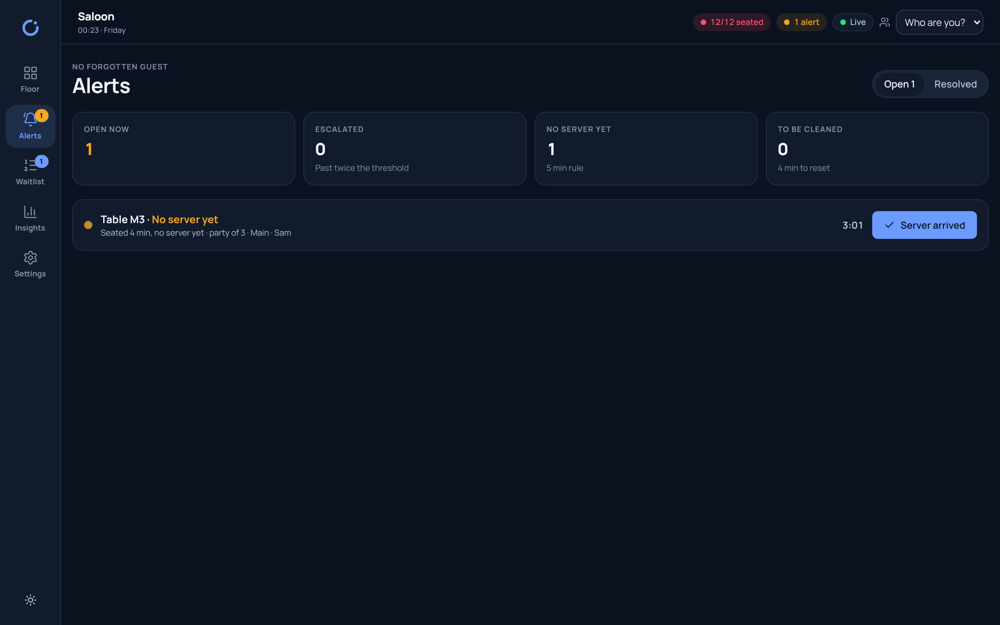
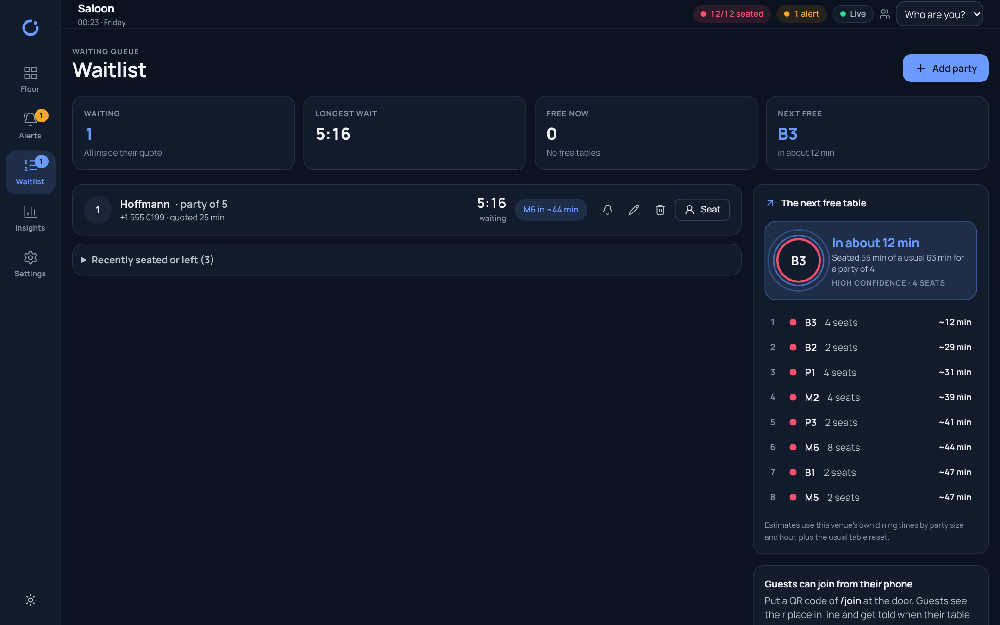
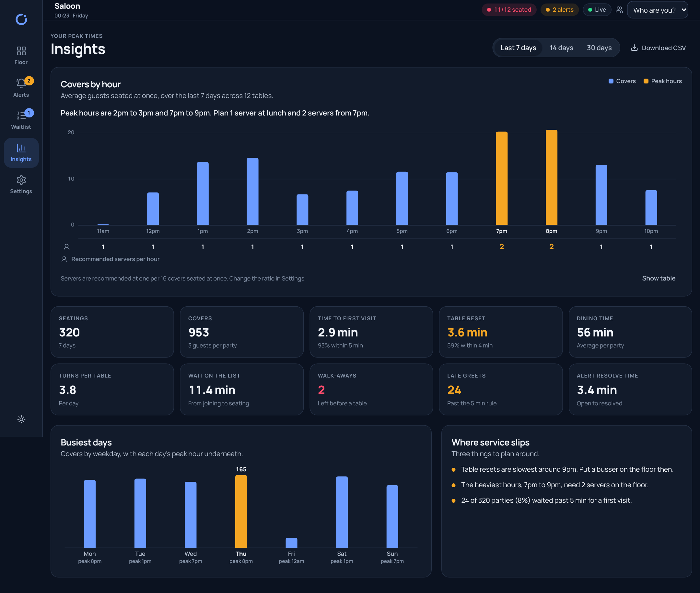
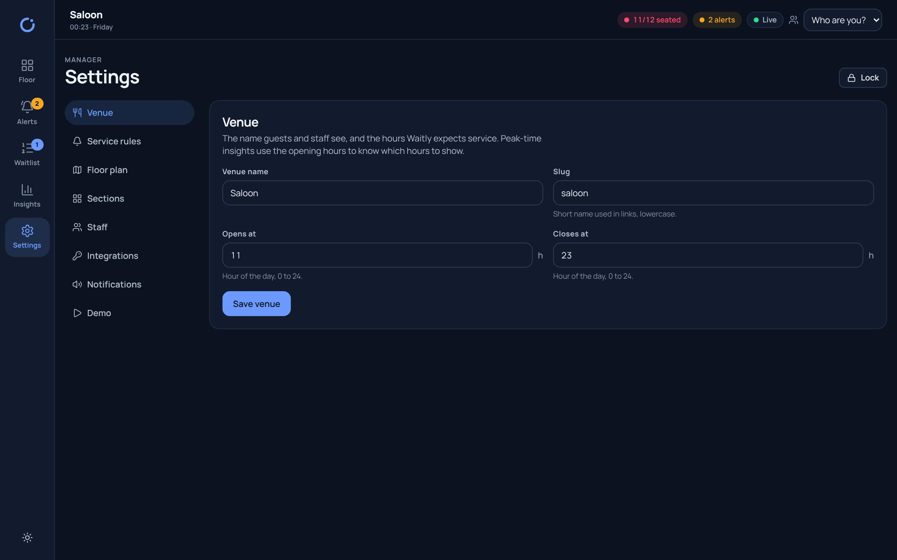
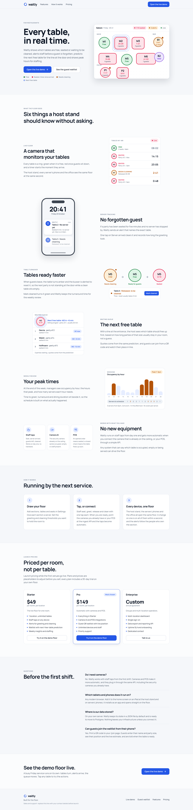
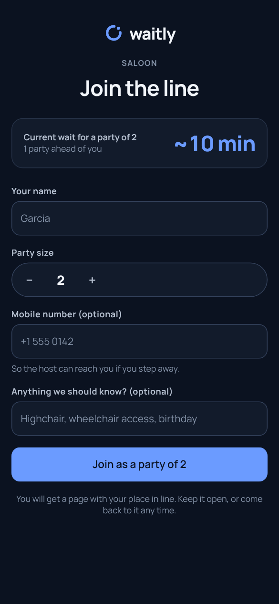

<p align="left">
  
</p>

# Waitly

**Every table, in real time.** Waitly is the live floor for restaurants: it shows which tables are free, seated or waiting to be cleaned, alerts staff before a guest is forgotten, predicts the next free table for the line at the door and shows peak hours so managers can schedule the right number of servers.

It works with staff taps from the first shift and becomes automatic when you connect the camera that is already on the ceiling, or your POS, through a small API.

## What it does

- **Live floor.** Every table is a ring: green when free, red once guests sit down with a timer since arrival, amber when it needs cleaning. Map and list views; the same floor on the host stand, servers' phones and the office.
- **No forgotten guest.** A party seated for five minutes with no server visit raises an alert naming the exact table; the threshold is yours to set. One tap on *Server arrived* resolves it and records the time to greet.
- **Tables ready faster.** When guests leave, the table turns amber and bussers are alerted to reset it; *Mark cleaned* turns it green and the turnaround time is kept for the weekly review.
- **The next free table.** With a line at the entrance, staff see which table should free up first, from the venue's own dining durations by party size and hour. Quotes are suggested from the same prediction; guests can join from a QR code and watch their place in line.
- **Your peak times.** Occupancy by hour, peak hours, recommended servers per hour, time to greet, turnaround, dining duration, waits and walk-aways.
- **No new equipment.** Staff taps, camera AI and POS all feed the same floor through one ingest API. A staff tap always wins over a camera for a minute.

## Screenshots

| Floor | Alerts | Waitlist |
|---|---|---|
|  |  |  |

| Insights | Settings | Landing | Guest |
|---|---|---|---|
|  |  |  |  |

## Quick start

Requirements: Node 22 or newer.

```bash
npm install
npm run dev
```

Open <http://localhost:3000>. The landing page is at `/`, the floor at `/app/floor`, the guest waitlist at `/join`.

- The first run seeds a demo venue ("Saloon") with twelve tables, three sections, staff, two weeks of history and a busy Friday evening already in progress.
- **Demo mode** is on by default: a simulation seats parties, sends servers, releases and cleans tables and moves the queue, on real time, so a two-minute look shows the whole loop. Turn it off in *Settings → Demo* when you set up your own floor.
- The manager PIN for Settings is **1234**. Change it in *Settings → Venue*.
- State is saved to `data/waitly.json` (ignored by git). Delete the file to reseed.

### Scripts

| Command | What it does |
|---|---|
| `npm run dev` | Development server with hot reload |
| `npm run build` | Production build (standalone output) |
| `npm run start` | Serve the production build |
| `npm run lint` | ESLint |
| `npx vitest run` | Unit tests for the alert rules, the prediction, the insights and the store |

## Using it on the floor

- **Host stand.** Open `/app/floor` on an iPad. Tap a table for its actions: *Seat party*, *Server arrived*, *Guests left*, *Mark cleaned*, *Hold*, a note. Seat straight from the waitlist when a fitting table turns free.
- **Servers' phones.** The same URL. Add it to the home screen: Waitly installs as an app and opens on the floor. Pick your name in the header so greets and resolutions carry your name.
- **Alerts.** Open alerts sit in the header, on the floor's side panel and on the Alerts screen, with the one action that resolves each. New alerts chime on the host stand and, once allowed, show as browser notifications when the tab is in the background.
- **Waitlist.** Add parties with a suggested quote, see the predicted table and ETA for each, notify, seat or remove them. Print a QR code to `/join` so guests can add themselves.
- **Insights.** Occupancy by hour for the last 7, 14 or 30 days, peak hours, recommended servers per hour and service metrics.
- **Settings.** Venue and hours, thresholds, tables and sections, staff and sections, integrations (API key), notifications, demo mode.

## Integrations

### Ingest API (camera AI and POS)

Any system that can say which table is occupied, empty or being served can drive the floor. Send events with the API key from *Settings → Integrations*.

```bash
# One event
curl -X POST http://localhost:3000/api/ingest \
  -H "Content-Type: application/json" \
  -H "x-waitly-key: $WAITLY_KEY" \
  -d '{"table":"M4","state":"occupied","confidence":0.93,"partySize":3}'

# A batch
curl -X POST http://localhost:3000/api/ingest \
  -H "Content-Type: application/json" \
  -H "x-waitly-key: $WAITLY_KEY" \
  -d '{"events":[{"table":"M2","state":"staff_present"},{"table":"M7","state":"empty"}]}'

# From a POS (an opened order means seated)
curl -X POST http://localhost:3000/api/ingest \
  -H "x-waitly-key: $WAITLY_KEY" -H "Content-Type: application/json" \
  -d '{"tableId":"t_m2","state":"occupied","partySize":4,"source":"pos"}'
```

Fields: `table` (label, e.g. `M4`) or `tableId`; `state` is one of `occupied`, `empty`, `staff_present`; optional `confidence` (0–1, events under 0.6 are ignored), `partySize`, `ts`, `source` (`camera`, default, or `pos`).

Rules: `occupied` on a free or dirty table seats it; `empty` on a seated table releases it (needs cleaning); `staff_present` on a seated table counts as a server visit. After a staff tap on a table, camera and POS events for that table are ignored for 60 seconds, so a human is never overruled by a model.

### Public waitlist

```
POST   /api/waitlist          { name, size, phone?, notes? }  → { partyId, quotedMinutes, position }
GET    /api/waitlist?size=4   → { quotedMinutes, waiting, venue }
GET    /api/waitlist/:id      → { party, position, etaMin, tableLabel }
DELETE /api/waitlist/:id      → leaves the line
```

### Live state

```
GET  /api/state      full snapshot (tables, alerts, parties, staff, predictions, suggestions)
GET  /api/stream     Server-Sent Events; a `snapshot` event on every change, heartbeat every 15 s
POST /api/actions    { action, staffId? } — the same commands the app sends
GET  /api/insights?days=7
GET  /api/health
```

## Architecture

- **Next.js 16 (App Router)** for the pages and the API routes. The app shell is a client tree fed by one SSE connection; timers run on the client so they never stall between updates.
- **One in-process store** (`src/server/store.ts`) owns the venue state, applies every command, runs the SLA rules every two seconds, fans out snapshots to SSE subscribers and persists to `data/waitly.json` (or `WAITLY_DATA_DIR`) with a debounced atomic write.
- **Pure logic in `src/lib`**, covered by Vitest: alert rules (`alerts.ts`), the next-free-table prediction and quotes (`predict.ts`), weekly insights and staffing (`insights.ts`).
- **Demo simulation** (`src/server/sim.ts`) drives the floor through the same commands staff use, tagged with source `sim`.
- **Persistence swap.** The store reads one `State` object on boot and writes it back on change (`src/server/persist.ts`). To move to Postgres, replace `loadState`/`saveState` with a row per venue (or event sourcing from `state.events`) and run one app instance per venue group; the API and UI do not change. For several instances, replace the in-memory subscriber set with a pub/sub channel (Redis) so every instance fans out the same snapshot.

## Deployment

The app is a long-running Node server (SSE and an in-process store), so run it as a container or on a VM. Serverless platforms such as Vercel need an external store and an SSE-capable runtime; use a container there instead.

```bash
docker compose up --build
# or
docker build -t waitly . && docker run -p 3000:3000 -v waitly-data:/app/data waitly
```

The image uses Next.js standalone output, runs as a non-root user and keeps its state in the `/app/data` volume. It runs unchanged on Railway, Fly.io, Render, or any Docker host.

### Configuration

| Variable | Default | Meaning |
|---|---|---|
| `PORT` | `3000` | Port to listen on |
| `WAITLY_DATA_DIR` | `./data` | Folder for `waitly.json` |

Everything else (thresholds, API key, PIN, demo mode) is set in *Settings* and stored with the venue.

## Brand

The brand is documented in [BRAND.md](BRAND.md): name, mark, colour tokens for both themes, type, voice. Logo files are in `brand/logo/`. The full design system (tokens, brand book, logos, components) is published as a Claude design-system artifact: <https://claude.ai/artifact/Cxhgbek3EtkfU91RVsaEDy> (private until shared).

The product specification derived from the source video, with the verbatim transcript and the scene-by-scene feature map, is in [docs/FEATURES.md](docs/FEATURES.md).

## Roadmap

- SMS to guests when the table is ready (Twilio) and Web Push for staff alerts
- Postgres persistence and multi-instance fan-out
- Multi-location dashboard for groups
- POS adapters (Toast, Square, Lightspeed) and camera-AI reference adapters
- Floor editor with drag-and-drop placement

## License

Proprietary. All rights reserved.
